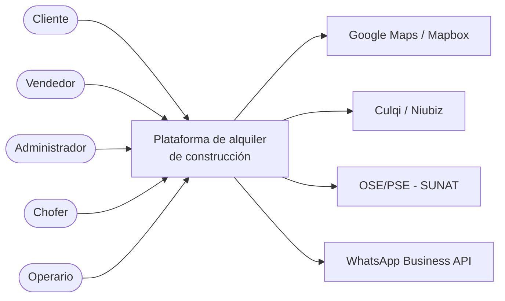

# 01 · Actores del sistema

## Actores primarios (usuarios)

| Actor | Descripción | Interacción principal |
|---|---|---|
| **Cliente** | Persona natural o empresa (con RUC) que alquila equipos o personal | Consulta el catálogo, solicita cotizaciones, reserva y sigue su alquiler |
| **Vendedor** | Personal comercial de la empresa | Atiende clientes, emite cotizaciones y registra contactos |
| **Administrador** | Responsable de la operación | Gestiona catálogo, precios, usuarios, reportes y configuración |
| **Chofer / Logística** | Encargado de entregas y recojos | Recibe rutas, actualiza estados y registra actas con fotos y firma |
| **Operario** | Personal instantáneo (operador, maestro, peón) | Recibe asignaciones y confirma su asistencia en obra |

## Actores secundarios (sistemas externos)

| Sistema | Propósito |
|---|---|
| Google Maps / Mapbox | Geocodificación de direcciones, cálculo de rutas y distancias |
| Culqi / Niubiz | Procesamiento de pagos (tarjeta, Yape, Plin) |
| OSE/PSE (ej. Nubefact) | Emisión de boletas y facturas electrónicas ante SUNAT |
| WhatsApp Business API | Envío de cotizaciones, recordatorios y confirmaciones |

## Diagrama de actores

