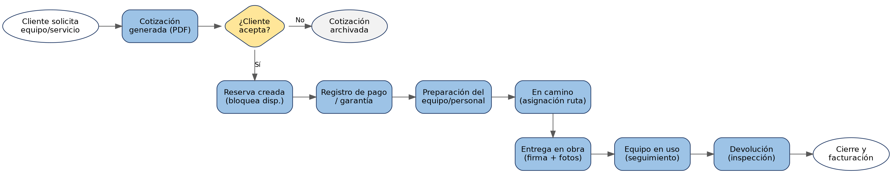
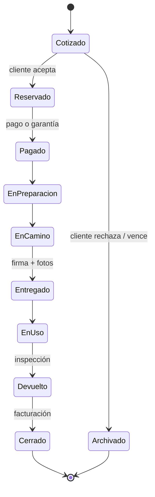

# 03 · Requisitos funcionales

| ID | Requisito | Módulo | Prioridad |
|---|---|---|---|
| RF01 | Registrar, editar y consultar equipos, maquinaria y personal | Catálogo | Alta |
| RF02 | Administrar categorías y fichas técnicas con fotos | Catálogo | Media |
| RF03 | Consultar disponibilidad de un equipo por rango de fechas | Reservas | Alta |
| RF04 | Evitar reservas duplicadas (doble alquiler) | Reservas | Alta |
| RF05 | Generar cotizaciones con número correlativo y vigencia | Cotizaciones | Alta |
| RF06 | Calcular tarifas por día, semana o mes con descuentos | Cotizaciones | Alta |
| RF07 | Calcular flete según la distancia a la obra | Cotizaciones / Logística | Media |
| RF08 | Exportar la cotización en PDF y enviarla por correo/WhatsApp | Cotizaciones / Notificaciones | Alta |
| RF09 | Convertir una cotización aceptada en orden de alquiler | Reservas | Alta |
| RF10 | Registrar clientes (persona natural o empresa con RUC) | CRM | Alta |
| RF11 | Registrar múltiples direcciones de obra con ubicación en mapa | CRM / Logística | Alta |
| RF12 | Registrar historial de contactos (llamadas, mensajes, notas) | CRM | Alta |
| RF13 | Registrar consentimiento para grabación de contacto | CRM | Alta |
| RF14 | Gestionar el estado del alquiler (cotizado → … → cerrado) | Reservas | Alta |
| RF15 | Asignar chofer y vehículo a una entrega | Logística | Media |
| RF16 | Registrar acta de entrega/devolución con fotos y firma | Logística | Media |
| RF17 | Registrar pagos, garantías y penalidades | Pagos | Media |
| RF18 | Emitir boleta/factura electrónica (SUNAT) | Pagos | Media |
| RF19 | Registrar mantenimientos y bloquear equipos no operativos | Mantenimiento | Media |
| RF20 | Enviar notificaciones y recordatorios automáticos | Notificaciones | Media |
| RF21 | Autenticar usuarios y controlar acceso por roles | Seguridad | Alta |
| RF22 | Generar reportes (ingresos, utilización, clientes frecuentes) | Reportes | Baja |

## Flujo principal del alquiler

### Estados del alquiler

