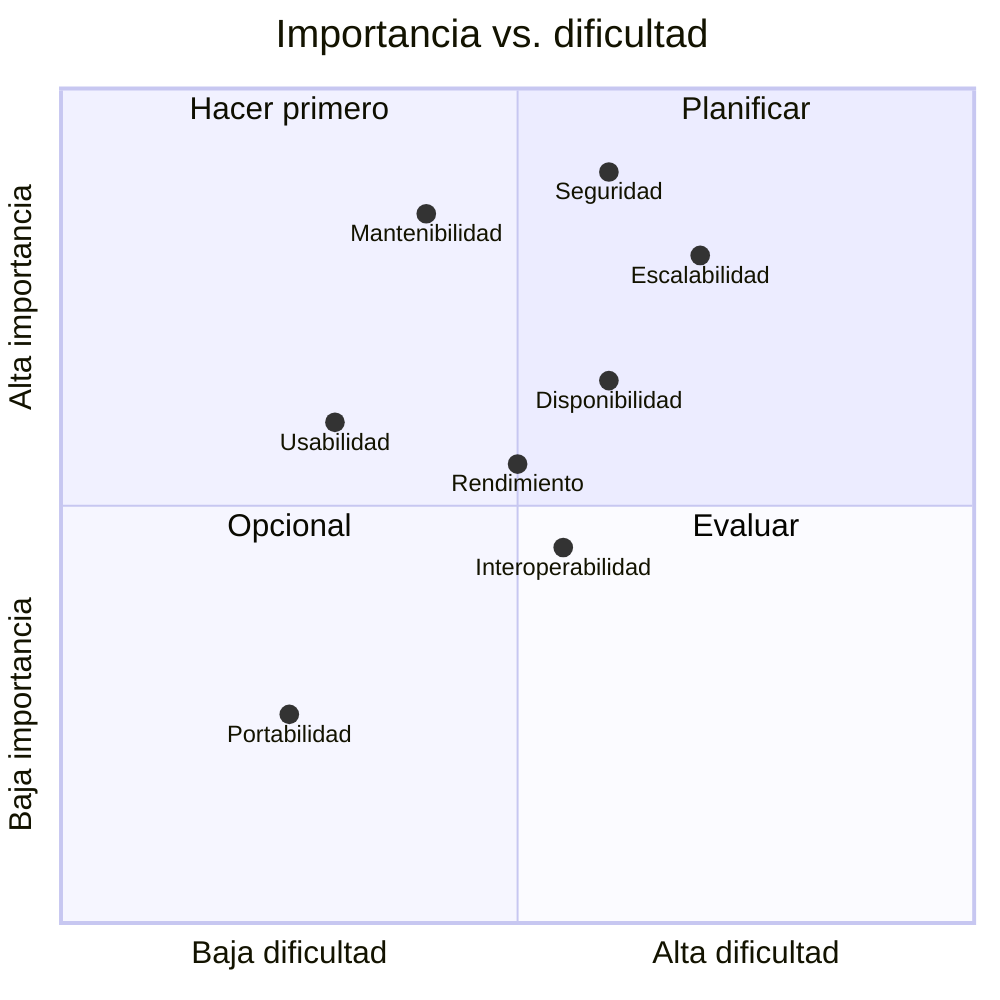

# 04 · Atributos de calidad

Basado en el modelo de calidad **ISO/IEC 25010**.

| Atributo | Prioridad | Descripción en el contexto del proyecto | Métrica objetivo |
|---|---|---|---|
| **Seguridad** | Alta | Protección de datos personales de clientes y control de acceso por roles | 100 % de endpoints protegidos; cifrado TLS 1.2+ |
| **Escalabilidad** | Alta | Soportar el crecimiento de catálogo, clientes y alquileres concurrentes | Escalado horizontal sin cambios de código |
| **Mantenibilidad** | Alta | Módulos desacoplados que permitan cambios localizados | Cobertura de pruebas ≥ 70 % en dominio |
| **Disponibilidad** | Media-Alta | Operación estable en horario comercial extendido | ≥ 99.5 % mensual |
| **Rendimiento** | Media | Respuesta rápida en consulta de disponibilidad y cálculo de cotización | p95 < 2 s |
| **Usabilidad** | Media | Interfaz simple para choferes y clientes con poca experiencia digital | Flujo de cotización en ≤ 5 pasos |
| **Interoperabilidad** | Media | Integración con mapas, pagos, SUNAT y WhatsApp | APIs desacopladas mediante adaptadores |
| **Fiabilidad** | Media | Consistencia de reservas y pagos ante fallos | Transacciones ACID; reintentos con idempotencia |
| **Portabilidad** | Baja | Despliegue en cualquier proveedor cloud | Contenedores Docker |
| **Cumplimiento legal** | Alta | Ley N.° 29733 y normativa SUNAT | Consentimiento registrado; comprobantes válidos |

## Priorización

