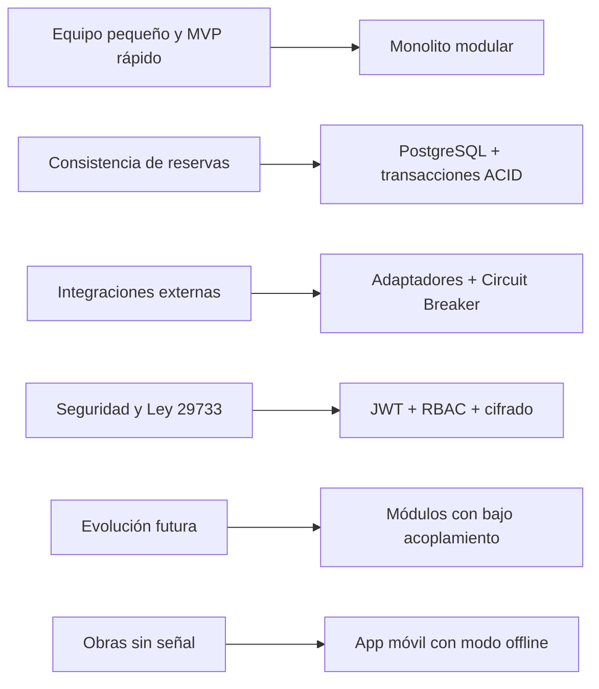

# 06 · Drivers arquitectónicos

Los **drivers** son los requisitos que más influyen en las decisiones de arquitectura.

## 1. Objetivos de negocio
- Reducir errores y tiempo en cotizaciones y reservas.
- Centralizar el historial comercial de cada cliente.
- Permitir crecer a más sedes, equipos y líneas de servicio.

## 2. Requisitos funcionales significativos
| Driver | Impacto arquitectónico |
|---|---|
| Disponibilidad por fechas y prevención de doble reserva | Transacciones ACID, bloqueo/consistencia en el módulo de Reservas |
| Cotizador con múltiples reglas de tarifa | Patrón Strategy en el dominio de Cotizaciones |
| Direcciones y rutas en mapa | PostGIS + integración con servicio de mapas |
| Contacto grabado con consentimiento | Almacenamiento de archivos + trazabilidad del consentimiento |
| Estados del alquiler con evidencia | Máquina de estados + almacenamiento de fotos/firmas |

## 3. Atributos de calidad críticos
| Atributo | Driver |
|---|---|
| Seguridad | Datos personales y financieros; Ley N.° 29733 |
| Escalabilidad | Crecimiento de catálogo y usuarios |
| Mantenibilidad | Equipo pequeño, evolución por fases |
| Disponibilidad | Operación diaria de despacho y entregas |

## 4. Restricciones principales
- Stack TypeScript + PostgreSQL + Docker.
- Integraciones obligatorias: SUNAT (OSE/PSE), pasarela de pago local, WhatsApp.
- Conectividad limitada en obra → modo offline en la app del chofer.

## 5. Resumen de drivers → decisiones

