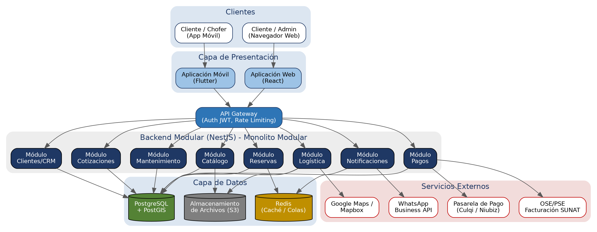
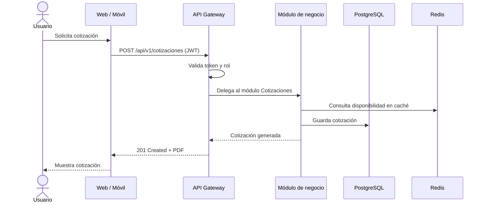
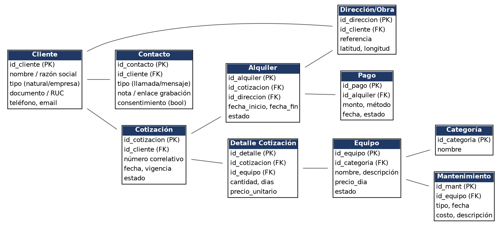
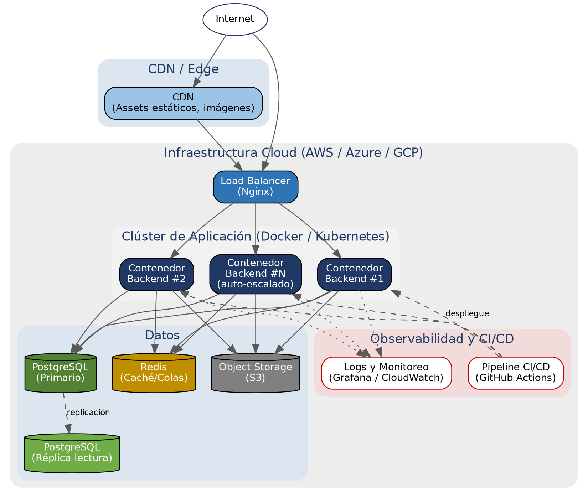

# Arquitectura inicial

Visión general de la arquitectura propuesta para la plataforma de alquiler de herramientas, maquinaria y personal de construcción.

## Vista general

## Capas del sistema

| Capa | Responsabilidad | Tecnología |
|---|---|---|
| Presentación | Interfaces para cliente, vendedor, administrador y chofer | React (web) · Flutter (móvil) |
| API Gateway | Autenticación, autorización, enrutamiento y límite de tasa | NestJS (guards/interceptors) |
| Aplicación / Dominio | Módulos de negocio con Clean Architecture | NestJS + TypeScript |
| Datos | Persistencia, caché y archivos | PostgreSQL + PostGIS · Redis · S3 |
| Integraciones | Servicios externos | Google Maps · Culqi/Niubiz · Nubefact · WhatsApp |
| Infraestructura | Despliegue y observabilidad | Docker · Nginx · GitHub Actions · Grafana |

## Flujo general de una petición

## Modelo de datos

## Despliegue

## Módulos del sistema

Catálogo · Reservas · Cotizaciones · Clientes/CRM · Logística · Pagos · Mantenimiento · Notificaciones · Seguridad.

Detalle en [componentes-arquitectonicos.md](./componentes-arquitectonicos.md).
