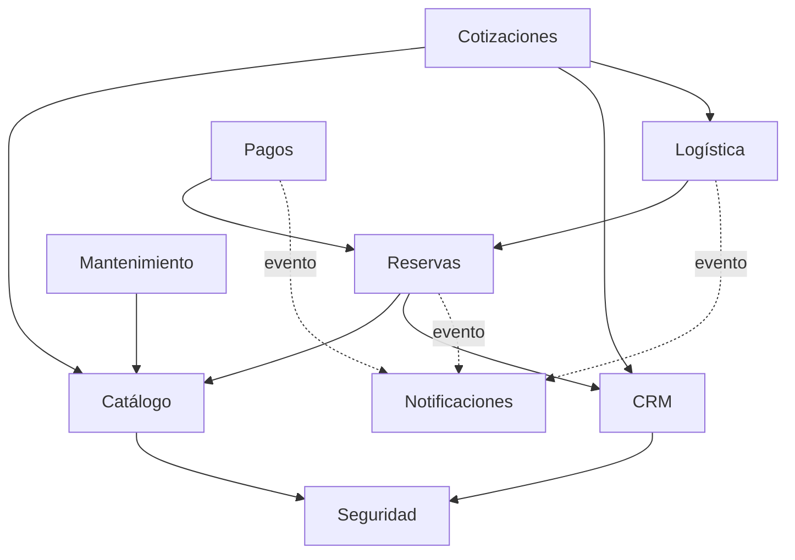

# Componentes arquitectónicos

## Componentes de presentación
| Componente | Descripción |
|---|---|
| Web App (React) | Panel de administración y ventas; también acceso para clientes |
| Mobile App (Flutter) | App para clientes y choferes, con modo offline |

## Componentes de backend (módulos)

| Módulo | Responsabilidad | Depende de |
|---|---|---|
| **Seguridad** | Autenticación JWT, roles, auditoría | — |
| **Catálogo** | Equipos, personal, categorías, fichas técnicas | Seguridad |
| **CRM** | Clientes, obras, historial de contactos, consentimientos | Seguridad |
| **Reservas** | Disponibilidad, reservas, estados del alquiler | Catálogo, CRM |
| **Cotizaciones** | Cálculo de tarifas, flete, PDF, correlativos | Catálogo, CRM, Logística |
| **Logística** | Rutas, choferes, vehículos, actas de entrega | Reservas, CRM |
| **Pagos** | Pagos, garantías, penalidades, facturación SUNAT | Reservas |
| **Mantenimiento** | Historial de mantenimiento y estado del equipo | Catálogo |
| **Notificaciones** | Correo y WhatsApp, recordatorios (asíncrono) | Redis (cola) |

> Las flechas punteadas representan comunicación **asíncrona por eventos**; las continuas, dependencias directas mediante interfaces.

## Componentes de datos
| Componente | Uso |
|---|---|
| PostgreSQL + PostGIS | Datos transaccionales y geoespaciales |
| Redis | Caché de catálogo/disponibilidad y cola de tareas |
| Object Storage (S3) | Fotos, actas firmadas, PDFs y grabaciones |

## Componentes de integración
| Servicio | Adaptador | Módulo |
|---|---|---|
| Google Maps / Mapbox | `MapsAdapter` | Logística |
| Culqi / Niubiz | `PaymentGatewayAdapter` | Pagos |
| OSE/PSE (Nubefact) | `InvoiceAdapter` | Pagos |
| WhatsApp Business API | `MessagingAdapter` | Notificaciones |

## Componentes de infraestructura
Nginx (balanceador) · Docker/Kubernetes · GitHub Actions (CI/CD) · Grafana/CloudWatch (observabilidad).
