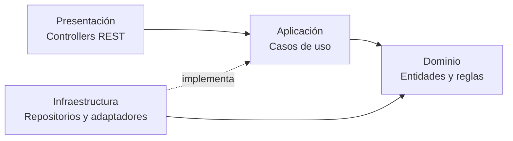

# Enfoque arquitectónico

Principios y enfoques que guían el diseño de la arquitectura.

## 1. Diseño guiado por el dominio (DDD ligero)
Se identifican **contextos delimitados** (bounded contexts) alineados con los módulos: Catálogo, Reservas, Cotizaciones, CRM, Logística, Pagos, Mantenimiento y Notificaciones. Cada uno tiene su propio modelo y lenguaje.

## 2. Modularidad primero
El sistema se divide por **capacidades de negocio**, no por capas técnicas globales. Esto facilita el trabajo en paralelo y la futura extracción a microservicios.

## 3. Clean Architecture
Las dependencias apuntan hacia el dominio. El dominio no conoce frameworks, base de datos ni servicios externos.

## 4. API-first
La API REST versionada (`/api/v1`) es el contrato central. Web y móvil la consumen de forma idéntica; se documenta con OpenAPI/Swagger.

## 5. Mobile-first y offline-first (choferes)
La experiencia en campo prioriza el móvil. La app del chofer funciona sin conexión y sincroniza después.

## 6. Eventos para desacoplar
Las acciones secundarias (notificaciones, PDFs, recordatorios) se procesan de forma asíncrona mediante eventos y colas.

## 7. Seguridad por diseño
Autenticación, autorización, cifrado y auditoría son transversales desde el inicio, con cumplimiento de la Ley N.° 29733.

## 8. Evolución incremental

| Fase | Enfoque |
|---|---|
| 1. MVP | Monolito modular con catálogo, cotizador, clientes, direcciones y estados |
| 2 | Pagos, facturación SUNAT, entregas con firma y fotos |
| 3 | Mantenimiento, reportes, WhatsApp, grabación de contactos |
| 4 | Extraer módulos críticos a microservicios; GPS/IoT; marketplace |
