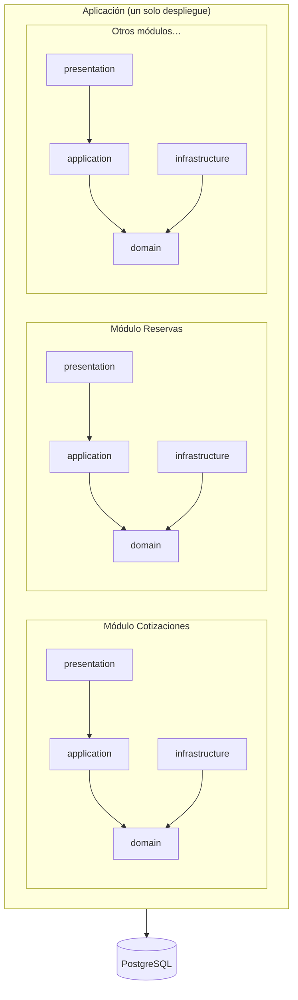

# Estilo arquitectónico

## Estilo elegido: Monolito modular + Clean Architecture

El sistema se despliega como **una única aplicación** internamente dividida en **módulos de negocio independientes**, cada uno estructurado en capas siguiendo Clean Architecture.

## Comparación de alternativas

| Criterio | Monolito tradicional | **Monolito modular** | Microservicios |
|---|---|---|---|
| Complejidad operativa | Baja | **Baja** | Alta |
| Tiempo de entrega del MVP | Rápido | **Rápido** | Lento |
| Acoplamiento | Alto | **Bajo (por módulos)** | Muy bajo |
| Consistencia transaccional | Simple | **Simple** | Compleja (sagas) |
| Escalado independiente | No | Parcial | Sí |
| Ideal para equipo pequeño | Sí | **Sí** | No |
| Evolución futura | Difícil | **Fácil** | — |

## Justificación
1. **Equipo reducido y MVP rápido:** menos infraestructura y menor costo operativo.
2. **Consistencia fuerte:** reservas y pagos requieren transacciones ACID.
3. **Preparado para crecer:** módulos con bajo acoplamiento y comunicación por interfaces/eventos.
4. **Pruebas más simples:** el dominio es independiente del framework.

## Reglas del estilo
- Un módulo **no accede directamente** a las tablas de otro; usa su interfaz pública.
- La comunicación asíncrona entre módulos se hace por **eventos de dominio**.
- Cada módulo mantiene sus propias entidades y repositorios.
- Las dependencias siempre apuntan hacia el **dominio**.

## Cuándo evolucionar a microservicios
- Un módulo requiere escalar de forma independiente (p. ej. Notificaciones o Catálogo).
- Equipos distintos necesitan ciclos de despliegue separados.
- Se incorporan cargas intensivas (GPS/IoT, analítica).
