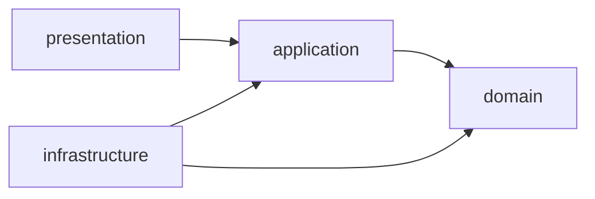
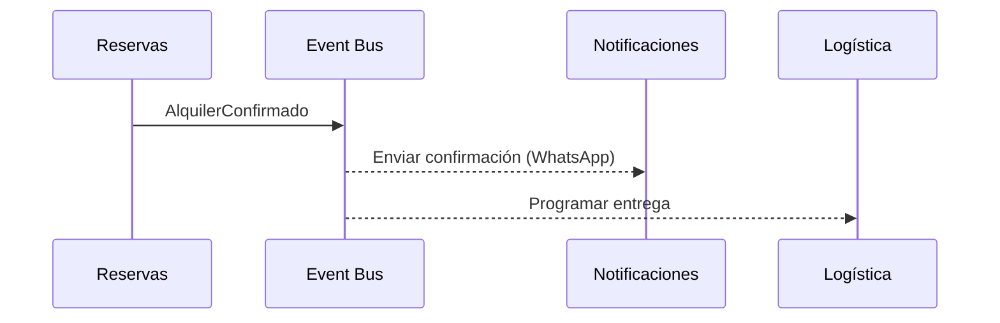

# Diseño interno de módulos

Cada módulo del monolito sigue la misma estructura de **Clean Architecture**.

## Estructura de carpetas de un módulo

```text
src/modules/cotizaciones/
├── domain/                     # Reglas de negocio puras (sin framework)
│   ├── entities/
│   │   ├── cotizacion.entity.ts
│   │   └── detalle-cotizacion.entity.ts
│   ├── value-objects/
│   │   └── dinero.vo.ts
│   ├── services/
│   │   └── calculadora-tarifa.ts        # Strategy
│   ├── repositories/
│   │   └── cotizacion.repository.ts     # Interfaz (puerto)
│   └── events/
│       └── cotizacion-creada.event.ts
├── application/                # Casos de uso
│   ├── use-cases/
│   │   ├── crear-cotizacion.use-case.ts
│   │   └── aceptar-cotizacion.use-case.ts
│   └── dtos/
│       └── crear-cotizacion.dto.ts
├── infrastructure/             # Detalles técnicos
│   ├── persistence/
│   │   ├── cotizacion.orm-entity.ts
│   │   └── cotizacion-typeorm.repository.ts
│   └── adapters/
│       └── pdf-generator.adapter.ts
├── presentation/               # Entrada HTTP
│   └── cotizaciones.controller.ts
└── cotizaciones.module.ts
```

## Responsabilidad de cada capa

| Capa | Contiene | Puede depender de |
|---|---|---|
| `domain` | Entidades, value objects, reglas, interfaces de repositorio, eventos | Nada |
| `application` | Casos de uso, DTOs, orquestación | `domain` |
| `infrastructure` | ORM, repositorios concretos, adaptadores externos | `domain`, `application` |
| `presentation` | Controladores, validaciones de entrada | `application` |

## Regla de dependencia



## Comunicación entre módulos

1. **Síncrona (interfaz pública):** un módulo expone un *facade/servicio* en su `module.ts` y los demás lo importan.
2. **Asíncrona (eventos):** se publican eventos de dominio (`AlquilerConfirmado`) que otros módulos escuchan.



## Módulos y su contenido principal

| Módulo | Entidades principales | Casos de uso clave |
|---|---|---|
| Catálogo | Equipo, Categoría, Personal | RegistrarEquipo, ConsultarFicha |
| Reservas | Alquiler, Reserva | VerificarDisponibilidad, ConfirmarAlquiler, CambiarEstado |
| Cotizaciones | Cotización, DetalleCotización | CrearCotización, GenerarPDF, AceptarCotización |
| CRM | Cliente, Dirección, Contacto | RegistrarCliente, RegistrarContacto |
| Logística | Entrega, Ruta, Vehículo | AsignarChofer, RegistrarActa |
| Pagos | Pago, Garantía, Comprobante | RegistrarPago, EmitirComprobante |
| Mantenimiento | Mantenimiento | ProgramarMantenimiento, BloquearEquipo |
| Notificaciones | Notificación, Plantilla | EnviarRecordatorio |
| Seguridad | Usuario, Rol | Autenticar, AutorizarRol |

## Convenciones
- Nombres de archivo en `kebab-case` con sufijo de tipo (`.entity.ts`, `.use-case.ts`, `.controller.ts`).
- Un caso de uso por clase, con un único método `execute()`.
- Los DTO validan con `class-validator`; las entidades de dominio no.
