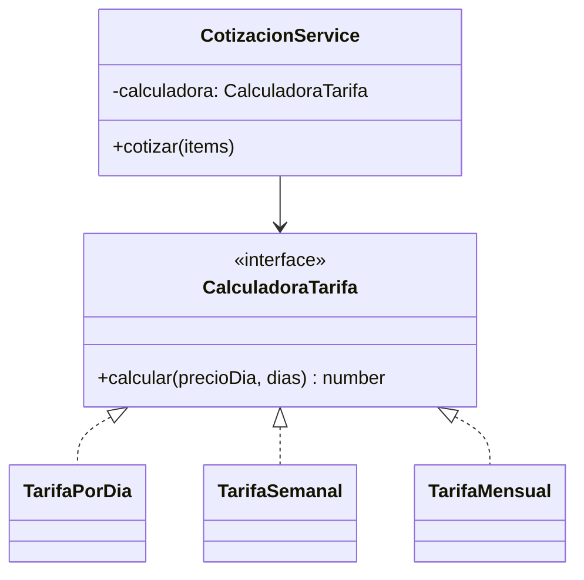

# Patrones de diseño

## Resumen

| Patrón | Tipo | Dónde se aplica |
|---|---|---|
| Repository | Estructural | Acceso a datos de cada módulo |
| Service Layer / Use Case | Aplicación | Lógica de negocio fuera de controladores |
| Strategy | Comportamiento | Cálculo de tarifas (día, semana, mes, kit) |
| Observer / Domain Events | Comportamiento | Notificaciones y reacciones entre módulos |
| State | Comportamiento | Estados del alquiler |
| Adapter | Estructural | Integraciones con mapas, pagos, SUNAT, WhatsApp |
| Factory | Creacional | Creación de cotizaciones/entidades con validación |
| DTO | Estructural | Transferencia de datos entre capas |
| Dependency Injection | Creacional | Inyección de repositorios y adaptadores (NestJS) |
| Circuit Breaker | Resiliencia | Llamadas a servicios externos |
| API Gateway | Estructural | Punto único de entrada con autenticación |

---

## Strategy · Cálculo de tarifa

```typescript
export interface CalculadoraTarifa {
  calcular(precioDia: number, dias: number): number;
}

export class TarifaPorDia implements CalculadoraTarifa {
  calcular(precioDia: number, dias: number): number {
    return precioDia * dias;
  }
}

export class TarifaSemanal implements CalculadoraTarifa {
  calcular(precioDia: number, dias: number): number {
    const semanas = Math.floor(dias / 7);
    const resto = dias % 7;
    return semanas * precioDia * 6 + resto * precioDia; // 1 día gratis por semana
  }
}

export class TarifaMensual implements CalculadoraTarifa {
  calcular(precioDia: number, dias: number): number {
    return precioDia * dias * 0.8; // 20 % de descuento
  }
}
```



## Repository · Acceso a datos

```typescript
// domain/repositories/cotizacion.repository.ts
export interface CotizacionRepository {
  guardar(cotizacion: Cotizacion): Promise<void>;
  buscarPorId(id: string): Promise<Cotizacion | null>;
  siguienteCorrelativo(): Promise<string>;
}

// infrastructure/persistence/cotizacion-typeorm.repository.ts
@Injectable()
export class CotizacionTypeormRepository implements CotizacionRepository {
  constructor(@InjectRepository(CotizacionOrm) private readonly repo: Repository<CotizacionOrm>) {}
  async guardar(c: Cotizacion) { await this.repo.save(CotizacionMapper.toOrm(c)); }
  async buscarPorId(id: string) { /* ... */ return null; }
  async siguienteCorrelativo() { /* ... */ return 'COT-000001'; }
}
```

## State · Estados del alquiler

```typescript
export type EstadoAlquiler =
  | 'COTIZADO' | 'RESERVADO' | 'PAGADO' | 'EN_PREPARACION'
  | 'EN_CAMINO' | 'ENTREGADO' | 'EN_USO' | 'DEVUELTO' | 'CERRADO';

const TRANSICIONES: Record<EstadoAlquiler, EstadoAlquiler[]> = {
  COTIZADO: ['RESERVADO'],
  RESERVADO: ['PAGADO'],
  PAGADO: ['EN_PREPARACION'],
  EN_PREPARACION: ['EN_CAMINO'],
  EN_CAMINO: ['ENTREGADO'],
  ENTREGADO: ['EN_USO'],
  EN_USO: ['DEVUELTO'],
  DEVUELTO: ['CERRADO'],
  CERRADO: [],
};

export class Alquiler {
  cambiarEstado(nuevo: EstadoAlquiler) {
    if (!TRANSICIONES[this.estado].includes(nuevo)) {
      throw new Error(`Transición inválida: ${this.estado} → ${nuevo}`);
    }
    this.estado = nuevo;
  }
}
```

## Observer · Eventos de dominio

```typescript
// Publicación
this.eventBus.publish(new AlquilerConfirmadoEvent(alquiler.id, cliente.id));

// Suscripción en Notificaciones
@EventsHandler(AlquilerConfirmadoEvent)
export class EnviarConfirmacionHandler implements IEventHandler<AlquilerConfirmadoEvent> {
  async handle(event: AlquilerConfirmadoEvent) {
    await this.mensajeria.enviarWhatsApp(event.clienteId, 'Tu alquiler fue confirmado');
  }
}
```

## Adapter · Integraciones externas

```typescript
export interface PasarelaPago {
  cobrar(monto: number, token: string): Promise<ResultadoPago>;
}

export class CulqiAdapter implements PasarelaPago { /* usa API de Culqi */ }
export class NiubizAdapter implements PasarelaPago { /* usa API de Niubiz */ }
```

## Circuit Breaker · Resiliencia
Se envuelven las llamadas a servicios externos (pagos, SUNAT, WhatsApp, mapas): tras *N* fallos el circuito se abre, se evita saturar al proveedor y se reintenta en segundo plano.

## Factory · Creación con validación

```typescript
export class CotizacionFactory {
  static crear(cliente: Cliente, items: ItemCotizacion[], correlativo: string): Cotizacion {
    if (items.length === 0) throw new Error('La cotización requiere al menos un ítem');
    return new Cotizacion(correlativo, cliente.id, items, addDays(new Date(), 5));
  }
}
```
