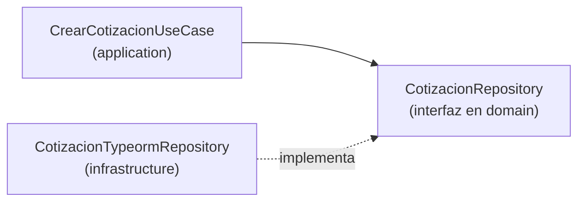

# Principios de diseño

## Principios SOLID

| Principio | Significado | Aplicación en el proyecto |
|---|---|---|
| **S**ingle Responsibility | Una clase, una razón para cambiar | Un caso de uso por clase (`CrearCotizacionUseCase`) |
| **O**pen/Closed | Abierto a extensión, cerrado a modificación | Nuevas tarifas con `Strategy` sin tocar las existentes |
| **L**iskov Substitution | Los subtipos deben poder sustituir a su tipo base | Cualquier `PasarelaPago` (Culqi/Niubiz) es intercambiable |
| **I**nterface Segregation | Interfaces pequeñas y específicas | `LectorCatalogo` y `EscritorCatalogo` separados |
| **D**ependency Inversion | Depender de abstracciones | El dominio depende de `CotizacionRepository`, no de TypeORM |

## Otros principios

| Principio | Descripción | Ejemplo |
|---|---|---|
| **DRY** | No repetir lógica | Cálculo de tarifa centralizado en el dominio |
| **KISS** | Mantenerlo simple | Monolito modular antes que microservicios |
| **YAGNI** | No construir lo que aún no se necesita | GPS/IoT y marketplace quedan para fases futuras |
| **Separación de responsabilidades** | Cada capa hace una sola cosa | Controladores sin lógica de negocio |
| **Alta cohesión, bajo acoplamiento** | Módulos independientes y bien delimitados | Comunicación por interfaces y eventos |
| **Ley de Demeter** | Hablar solo con colaboradores directos | Los módulos no acceden a tablas ajenas |
| **Fail fast** | Validar temprano | DTOs validados en el borde de la API |
| **Idempotencia** | Repetir una operación no cambia el resultado | Reintentos de pagos y notificaciones |

## Principios arquitectónicos del proyecto

1. **El dominio es el centro:** no depende de frameworks ni de la base de datos.
2. **Dependencias hacia adentro:** presentación → aplicación → dominio.
3. **Integraciones tras adaptadores:** los proveedores externos se pueden reemplazar.
4. **Seguridad por diseño:** autenticación, autorización y auditoría desde el inicio.
5. **Evolución incremental:** primero el MVP, luego las funciones avanzadas.
6. **Datos personales protegidos:** consentimiento y minimización (Ley N.° 29733).

## Ejemplo: Inversión de dependencias

