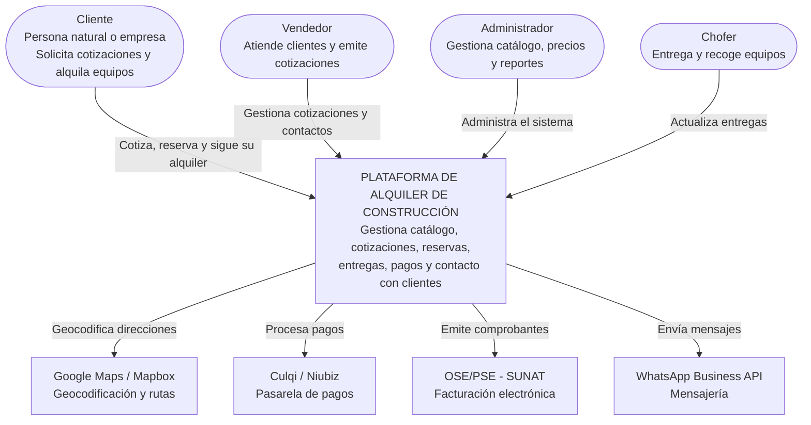

# C4 · Nivel 1 — Diagrama de contexto del sistema

Muestra el sistema como una caja negra, sus usuarios y los sistemas externos con los que interactúa.

## Elementos

| Elemento | Tipo | Descripción |
|---|---|---|
| Cliente | Persona | Persona natural o empresa con RUC que alquila |
| Vendedor | Persona | Personal comercial |
| Administrador | Persona | Responsable de la operación |
| Chofer | Persona | Encargado de logística |
| Plataforma de alquiler | Sistema | Sistema que se está diseñando |
| Google Maps / Mapbox | Sistema externo | Mapas y rutas |
| Culqi / Niubiz | Sistema externo | Pagos con tarjeta, Yape y Plin |
| OSE/PSE (SUNAT) | Sistema externo | Comprobantes electrónicos |
| WhatsApp Business API | Sistema externo | Notificaciones y cotizaciones |
