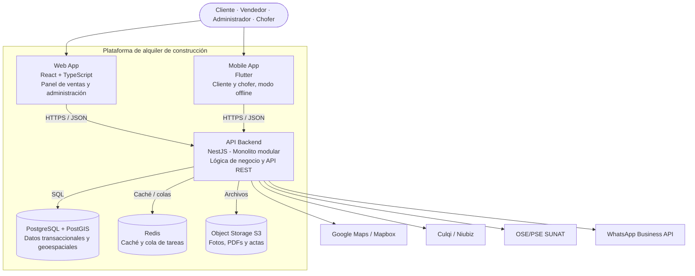

# C4 · Nivel 2 — Diagrama de contenedores

Descompone el sistema en aplicaciones y almacenes de datos desplegables.

## Contenedores

| Contenedor | Tecnología | Responsabilidad |
|---|---|---|
| Web App | React + TypeScript | Interfaz web para vendedores, administradores y clientes |
| Mobile App | Flutter | App para clientes y choferes con modo offline |
| API Backend | NestJS (Node.js) | Módulos de negocio, autenticación JWT, API REST `/api/v1` |
| Base de datos | PostgreSQL + PostGIS | Persistencia de datos y consultas geoespaciales |
| Redis | Redis | Caché de catálogo/disponibilidad y colas de mensajes |
| Almacenamiento | S3 | Archivos binarios (fotos, PDFs, firmas) |

## Referencia visual

## Despliegue

