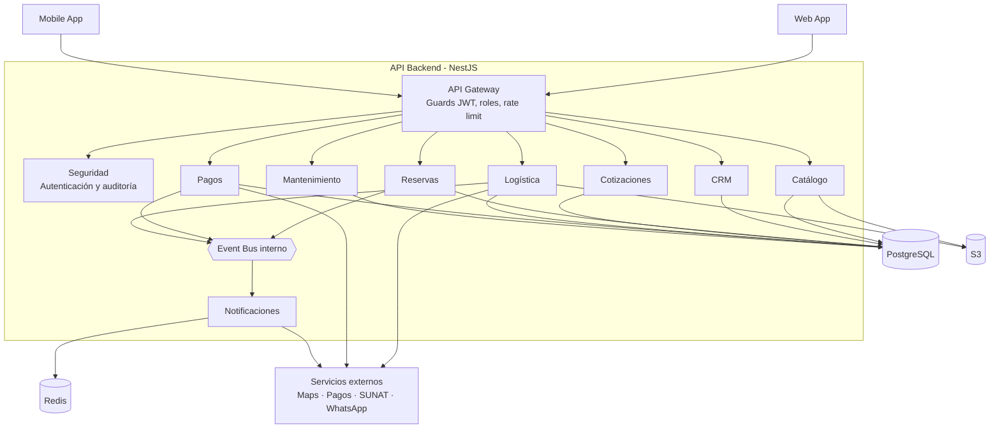
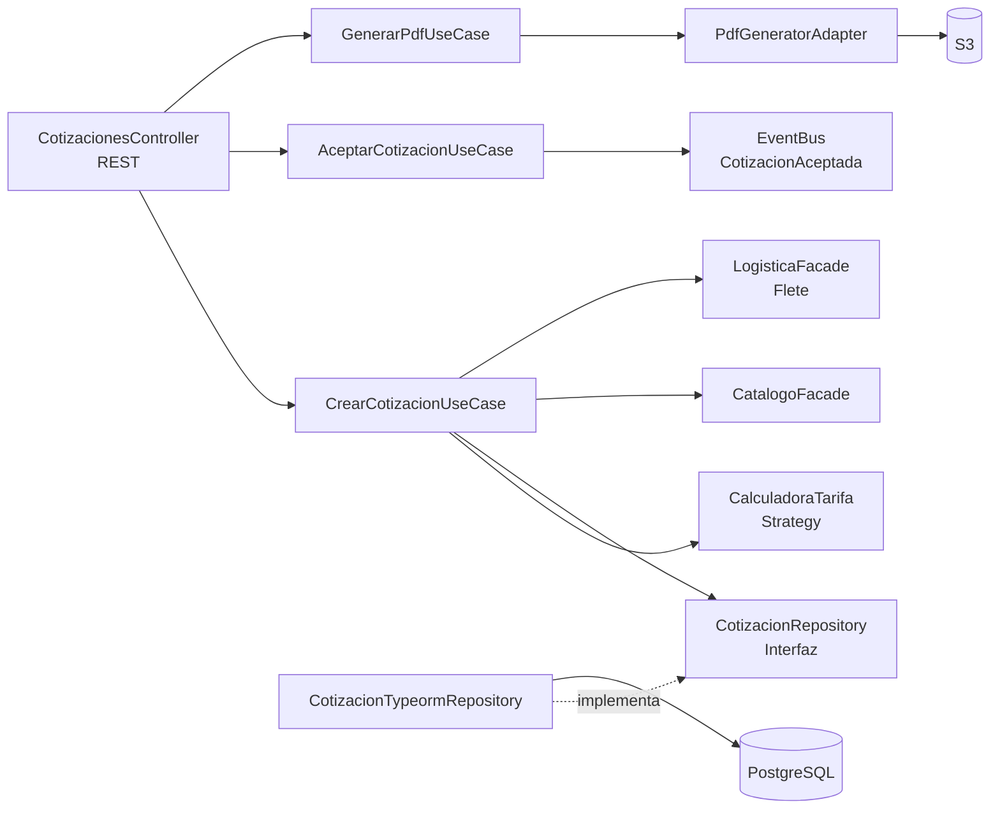

# C4 · Nivel 3 — Diagrama de componentes

Detalla los componentes internos del contenedor **API Backend (NestJS)**.

## Vista general de módulos

## Componentes internos del módulo Cotizaciones

## Descripción de componentes

| Componente | Responsabilidad |
|---|---|
| API Gateway | Valida JWT, aplica roles y límite de peticiones |
| Seguridad | Usuarios, roles, tokens y auditoría |
| Catálogo | Equipos, personal, categorías y fichas técnicas |
| CRM | Clientes, direcciones de obra, contactos y consentimientos |
| Reservas | Disponibilidad, reservas y máquina de estados del alquiler |
| Cotizaciones | Tarifas, descuentos, flete, correlativo y PDF |
| Logística | Rutas, choferes, vehículos y actas de entrega |
| Pagos | Pagos, garantías y facturación electrónica |
| Mantenimiento | Historial y estado operativo de los equipos |
| Notificaciones | Envío asíncrono de correos y mensajes de WhatsApp |
| Event Bus | Comunicación asíncrona entre módulos |
